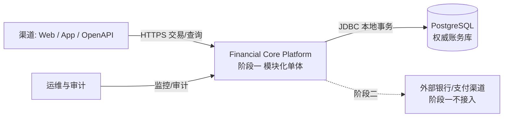
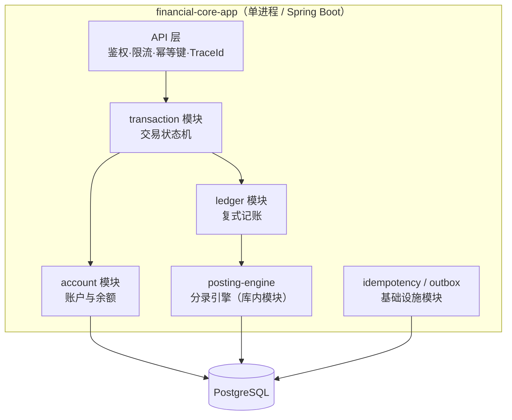

# 阶段一架构设计（HLD）

> 状态：设计中 · 对应 ADR-0001

## 一、架构定位

阶段一采用 **模块化单体（Modular Monolith）**：一个可部署单元、一个关系数据库、一个本地事务边界，内部按领域模块强隔离。

理由：金融核心的第一风险是资金正确性，而非扩展性。微服务/分布式事务会引入跨服务一致性问题，使正确性基线难以证明。先在一个进程 + 一个数据库事务内把账做对，阶段二再按真实瓶颈拆分，且每次拆分都能用同一套不变量测试衡量代价。见 `adr/0001-modular-monolith.md`。

## 二、C4 — L1 系统上下文



阶段一 **不接外部渠道**：无跨机构支付，因此不存在「支付结果延迟/不确定」的分布式难题，资金结算等同于账务入账。

## 三、C4 — L2 容器



要点：`posting-engine` 初期是 `ledger-service` 内部的 Java 模块，**不独立部署**，以避免不必要的跨服务事务（`README.txt` 第二节）。

## 四、模块边界与依赖规则

| 层 | 模块 | 允许依赖 | 禁止 |
| --- | --- | --- | --- |
| `common` | common-api / common-domain / common-utils / common-exception | 无 | 依赖任何业务模块 |
| `infrastructure` | idempotency / outbox / audit / observability | common | 直接调用业务模块 |
| `engines` | accounting-engine / posting-engine | common + infrastructure | 依赖 services |
| `services`(domain) | transaction / account / ledger | common + engines + infrastructure | 反向依赖 API 层 |
| `api` | REST Controller / DTO / 参数校验 | 全部下层 | 被下层依赖 |

硬性规则：

1. **账务唯一写入口**：只有 `ledger` 模块能写 `ledger_entry` / `journal` 表；`account` 模块只能由 ledger 通过同一事务更新余额。
2. **禁止跨模块直连数据库表**：模块间通过 Java 接口调用，不共享表访问。
3. **领域层不依赖框架**：状态机、借贷规则、不变量用纯 Java 表达，Spring 只在适配层。
4. 依赖方向单向向下，用 ArchUnit / Maven module 依赖在 CI 中强制校验。

## 五、分层（单模块内部）

```
interfaces (REST / 参数校验 / 幂等键解析)
    ↓
application (用例编排 / 事务边界 @Transactional / 命令与查询)
    ↓
domain (实体 / 值对象 / 状态机 / 借贷规则 / 不变量)  ← 无框架依赖
    ↓
infrastructure (JPA/MyBatis / Outbox / 审计 / 时钟 / ID 生成)
```

事务边界放在 **application 层**：一个用例方法 = 一个数据库本地事务，内部完成「幂等记录 + 交易状态 + 分录 + 余额 + Outbox 事件」的全部写入。

## 六、技术栈（阶段一裁剪版）

| 层次 | 选型 | 阶段一说明 |
| --- | --- | --- |
| 语言 | Java 21 | LTS，虚拟线程可用于提升并发（不用于账务正确性） |
| 框架 | Spring Boot 3.x | 事务管理、参数校验 |
| 持久层 | PostgreSQL + Flyway | 权威账务库；约束、行锁、隔离级别 |
| 缓存 | Redis（可选） | 仅查询缓存，禁止参与余额/分录判定 |
| 消息队列 | **无**（Outbox 表预留） | 阶段二才引入 Kafka |
| 测试 | JUnit 5 + Testcontainers + jqwik | 集成与属性测试 |
| 压测 | Gatling + JMH | 阶段一建立基线 |
| 可观测 | Micrometer + OpenTelemetry + 审计日志 | TraceId 贯穿 |

初期不引入 Flink、Spark、分布式数据库、多活架构（见 `README.txt` 第七节）。

## 七、部署拓扑（阶段一）

```
[客户端] → [单应用实例 ×N（无状态，可选）] → [PostgreSQL 主 + 同步/异步备]
                                          └→ [Redis 只读缓存（可降级）]
```

应用无状态可水平扩展；所有状态在 PostgreSQL。主备切换 RTO < 30 min、RPO ≤ 5 min（异步复制），阶段四再升级到多 AZ 自动切换。

## 八、关键设计原则

- **权威数据源唯一**（README 第三节）：余额与分录只在 PostgreSQL。
- **交易/账务/清算/结算分离**：阶段一仅交易 + 账务，清算结算留到阶段二。
- **金额用 BIGINT 最小单位**（ADR-0002）。
- **原子提交边界**（ADR-0003）：所有资金相关写入同一本地事务。
- **冲正用反向分录**（ADR-0004）。

## 九、ADR 索引

| 编号 | 决策 |
| --- | --- |
| [ADR-0001](adr/0001-modular-monolith.md) | 阶段一采用模块化单体 |
| [ADR-0002](adr/0002-money-as-minor-unit.md) | 金额以 BIGINT 最小货币单位存储 |
| [ADR-0003](adr/0003-single-db-transaction-boundary.md) | 单库事务作为资金写入原子边界 |
| [ADR-0004](adr/0004-reversal-by-reverse-entry.md) | 冲正通过反向分录实现 |
| [ADR-0005](adr/0005-idempotency-key.md) | 幂等键 + 唯一约束 + 结果快照 |

## 十、阶段二演进钩子

- `outbox_event` 表与 `idempotency_record` 在阶段一即建好并写入，阶段二接入 Kafka 投递即可，无需改账务逻辑。
- 模块边界按未来服务拆分线划分（transaction / account / ledger / reconciliation），拆分时尽量只替换进程间调用为 RPC。
