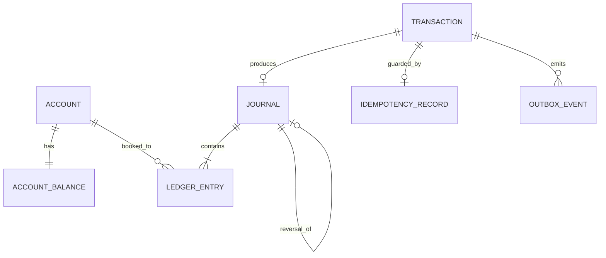

# 数据库设计（LLD）

> 状态：设计中 · PostgreSQL · 阶段一单库 · 依赖 ADR-0002 / ADR-0003

## 一、设计原则

- **关系数据库是唯一权威数据源**（README 第三节）；Redis 不参与资金正确性。
- 金额 `BIGINT` 最小货币单位（分）；禁止 `double`/`float`。
- 账务表只追加；靠约束与唯一索引把不变量下沉到数据库。
- 所有资金写入处于 **单一本地事务** 边界（ADR-0003）。
- Schema 由 **Flyway** 版本化管理，禁止手工改生产库。

## 二、ER 图



## 三、表清单

| 表 | 用途 | 写入特性 |
| --- | --- | --- |
| `account` | 账户主体 | 低频 |
| `account_balance` | 可用/冻结余额、version | 高频更新 |
| `transaction` | 交易状态机 | 高频 |
| `journal` | 凭证（借贷集合） | 只追加 |
| `ledger_entry` | 分录 | 只追加 |
| `idempotency_record` | 幂等键与结果快照 | 只追加 |
| `outbox_event` | 事务消息（阶段二投递） | 只追加 |
| `audit_log` | 审计 | 只追加 |

## 四、核心 DDL（阶段一最小集）

```sql
-- 金额单位：分（BIGINT）
CREATE TABLE account (
    account_id      BIGINT PRIMARY KEY,
    tenant_id       BIGINT      NOT NULL,
    account_no      VARCHAR(64) NOT NULL,
    currency        CHAR(3)     NOT NULL,
    ledger_set      VARCHAR(32) NOT NULL,
    status          VARCHAR(16) NOT NULL DEFAULT 'ACTIVE',
    created_at      TIMESTAMPTZ NOT NULL DEFAULT now(),
    UNIQUE (tenant_id, account_no)
);

CREATE TABLE account_balance (
    account_id         BIGINT PRIMARY KEY REFERENCES account(account_id),
    available_balance  BIGINT NOT NULL DEFAULT 0,
    frozen_balance     BIGINT NOT NULL DEFAULT 0,
    version            BIGINT NOT NULL DEFAULT 0,
    updated_at         TIMESTAMPTZ NOT NULL DEFAULT now(),
    CONSTRAINT chk_balance_nonneg CHECK (available_balance >= 0 AND frozen_balance >= 0)
);

CREATE TABLE transaction (
    transaction_id     BIGINT PRIMARY KEY,
    tenant_id          BIGINT      NOT NULL,
    idempotency_key    VARCHAR(128) NOT NULL,
    request_hash       CHAR(64)    NOT NULL,
    type               VARCHAR(24) NOT NULL,
    status             VARCHAR(24) NOT NULL,
    payer_account_id   BIGINT,
    payee_account_id   BIGINT,
    amount_minor       BIGINT      NOT NULL,
    currency           CHAR(3)     NOT NULL,
    journal_id         BIGINT,
    version            BIGINT      NOT NULL DEFAULT 0,
    next_retry_at      TIMESTAMPTZ,
    created_at         TIMESTAMPTZ NOT NULL DEFAULT now(),
    updated_at         TIMESTAMPTZ NOT NULL DEFAULT now(),
    UNIQUE (tenant_id, idempotency_key),
    CONSTRAINT chk_amount_positive CHECK (amount_minor > 0)
);

CREATE TABLE journal (
    journal_id     BIGINT PRIMARY KEY,
    biz_id         VARCHAR(128) NOT NULL,   -- = 业务交易号，保证不重复入账 (I-3)
    type           VARCHAR(24)  NOT NULL,
    currency       CHAR(3)      NOT NULL,
    ledger_set     VARCHAR(32)  NOT NULL,
    reversal_of    BIGINT REFERENCES journal(journal_id),
    reversed_by    BIGINT REFERENCES journal(journal_id),
    posted_at      TIMESTAMPTZ  NOT NULL DEFAULT now(),
    UNIQUE (biz_id)
);

CREATE TABLE ledger_entry (
    entry_id        BIGINT PRIMARY KEY,
    journal_id      BIGINT NOT NULL REFERENCES journal(journal_id),
    account_id      BIGINT NOT NULL REFERENCES account(account_id),
    direction       VARCHAR(6)  NOT NULL CHECK (direction IN ('DEBIT','CREDIT')),
    amount_minor    BIGINT      NOT NULL CHECK (amount_minor > 0),
    balance_before  BIGINT      NOT NULL,
    balance_after   BIGINT      NOT NULL,
    created_at      TIMESTAMPTZ NOT NULL DEFAULT now()
);
-- 无 UPDATE / DELETE 授权；仅 INSERT + SELECT

CREATE TABLE idempotency_record (
    idempotency_key  VARCHAR(128) NOT NULL,
    tenant_id        BIGINT       NOT NULL,
    transaction_id   BIGINT       NOT NULL,
    request_hash     CHAR(64)     NOT NULL,
    response_status  INT,
    response_body    TEXT,
    created_at       TIMESTAMPTZ  NOT NULL DEFAULT now(),
    PRIMARY KEY (tenant_id, idempotency_key)
);

CREATE TABLE outbox_event (
    event_id      BIGINT PRIMARY KEY,
    aggregate_id  BIGINT NOT NULL,
    event_type    VARCHAR(64) NOT NULL,
    payload       JSONB  NOT NULL,
    published     BOOLEAN NOT NULL DEFAULT FALSE,
    created_at    TIMESTAMPTZ NOT NULL DEFAULT now()
);
```

## 五、索引

| 表 | 索引 | 用途 |
| --- | --- | --- |
| `transaction` | `(status, next_retry_at)` | UNKNOWN/RECOVERING 恢复扫描 |
| `transaction` | `(tenant_id, idempotency_key)` UNIQUE | 幂等 |
| `journal` | `(biz_id)` UNIQUE | 不重复入账 |
| `journal` | `(reversal_of)` | 冲正追溯 |
| `ledger_entry` | `(journal_id)` | 凭证分录 |
| `ledger_entry` | `(account_id, created_at)` | 余额重算、账户流水 |
| `outbox_event` | `(published, created_at)` | 阶段二投递扫描 |

阶段一数据量小，暂不分区；阶段三引入按时间/账户分区（README 6.1 亿级场景）。

## 六、事务边界（最关键）

**一个本地事务 = 一次用例**，由 application 层 `@Transactional` 界定：

```
BEGIN;
  INSERT idempotency_record;             -- 幂等
  INSERT/UPDATE transaction;             -- 状态机
  UPDATE account_balance ... 条件更新;   -- 余额
  INSERT journal;
  INSERT ledger_entry x N;               -- 分录
  INSERT outbox_event;                  -- 阶段二事件
COMMIT;   -- 任一步失败 -> 整体 ROLLBACK
```

`README.txt` 4.2 明确：余额变动与账务分录必须放在 **同一原子提交边界**。禁止把余额放 Redis、分录放 DB，或分两次提交。

## 七、隔离级别与并发控制

- 默认 `READ COMMITTED`；配合 **条件更新** 保证并发扣款安全：

```sql
UPDATE account_balance
SET available_balance = available_balance - 8000,
    version = version + 1,
    updated_at = now()
WHERE account_id = 10001
  AND available_balance >= 8000;
-- 检查影响行数：为 0 表示余额不足，禁止扣款
```

- 转账涉及多账户时，按 `account_id` **排序后逐行 `SELECT ... FOR UPDATE`**，避免死锁。
- 不使用 `SERIALIZABLE`（阶段一无需，且带来额外冲突与性能损耗）；如需更强保证再评估。
- 状态迁移用 `version` CAS，见 `transaction-design.md`。

## 八、Flyway 约定

- 迁移脚本 `database/migrations/V1__init.sql`、`V2__...sql`，只追加不修改已发布版本。
- 每个迁移必须在单事务内可回滚演练；CI 用 Testcontainers 起空库跑全量迁移 + 集成测试。
- 约束（CHECK / UNIQUE / FK）优先写在 DDL，而非仅靠应用代码。

## 九、验收依据

- I-1~I-6 的校验 SQL 见 `consistency.md`。
- 1 亿条账务记录查询 P99 < 200 ms 属阶段三目标，本阶段仅保证索引与查询计划合理。
