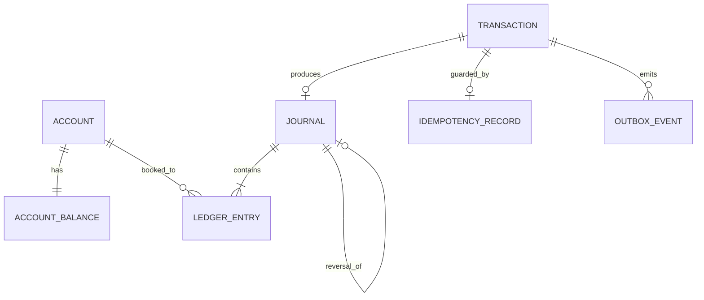

# 数据库设计（LLD）

> 状态：设计中 · MySQL 8（本机默认）/ PostgreSQL 双库 · 阶段一单库 · 依赖 ADR-0002 / ADR-0003 / ADR-0006

## 一、设计原则

- **关系数据库是唯一权威数据源**（README 第三节）；Redis 不参与资金正确性。
- 金额 `BIGINT` 最小货币单位（分）；禁止 `double`/`float`。
- 账务表只追加；靠约束与唯一索引把不变量下沉到数据库。
- 所有资金写入处于 **单一本地事务** 边界（ADR-0003）。
- Schema 由 **Flyway** 版本化管理，禁止手工改生产库。
- **默认本机 MySQL 8，保留 PostgreSQL**：方言差异收敛在 DDL 与配置，业务 SQL 保持可移植（ADR-0006）。
- **主键与时间戳一律由应用层写入**，避免 `AUTO_INCREMENT`/`BIGSERIAL`、`now()`/`ON UPDATE CURRENT_TIMESTAMP` 等方言默认值差异。

## 二、ER 图



## 三、表清单

| 表 | 用途 | 写入特性 |
| --- | --- | --- |
| `account` | 账户主体 | 低频 |
| `account_balance` | 可用/冻结余额、version | 高频更新 |
| `transaction` | 交易状态机 | 高频 |
| `journal` | 凭证（借贷集合） | 只追加 |
| `ledger_entry` | 分录 | 只追加 |
| `idempotency_record` | 幂等键与结果快照 | 只追加 |
| `outbox_event` | 事务消息（阶段二投递） | 只追加 |
| `audit_log` | 审计 | 只追加 |

## 四、核心 DDL（可移植逻辑模型）

以下为 **两库通用的逻辑 DDL**。实际建表脚本按厂商拆分在
`app/financial-core-app/src/main/resources/db/migration/{mysql,postgresql}/V1__init.sql`，差异见第十节。

```sql
-- 金额单位：分（BIGINT）；时间戳由应用层写入，不使用数据库默认值
CREATE TABLE account (
    account_id      BIGINT       NOT NULL,
    tenant_id       BIGINT       NOT NULL,
    account_no      VARCHAR(64)  NOT NULL,
    currency        CHAR(3)      NOT NULL,
    ledger_set      VARCHAR(32)  NOT NULL,
    status          VARCHAR(16)  NOT NULL,
    created_at      TIMESTAMP    NOT NULL,
    PRIMARY KEY (account_id),
    UNIQUE (tenant_id, account_no)
);

CREATE TABLE account_balance (
    account_id         BIGINT    NOT NULL,
    opening_balance    BIGINT    NOT NULL,   -- 开户期初余额；余额 = 期初 + 分录累计 (I-2)
    available_balance  BIGINT    NOT NULL,
    frozen_balance     BIGINT    NOT NULL,
    version            BIGINT    NOT NULL,
    updated_at         TIMESTAMP NOT NULL,
    PRIMARY KEY (account_id),
    CONSTRAINT chk_balance_nonneg CHECK (available_balance >= 0 AND frozen_balance >= 0)
);

CREATE TABLE transaction (
    transaction_id     BIGINT       NOT NULL,
    tenant_id          BIGINT       NOT NULL,
    idempotency_key    VARCHAR(128) NOT NULL,
    request_hash       CHAR(64)     NOT NULL,
    type               VARCHAR(24)  NOT NULL,
    status             VARCHAR(24)  NOT NULL,
    payer_account_id   BIGINT,
    payee_account_id   BIGINT,
    amount_minor       BIGINT       NOT NULL,
    currency           CHAR(3)      NOT NULL,
    journal_id         BIGINT,
    version            BIGINT       NOT NULL,
    next_retry_at      TIMESTAMP,
    created_at         TIMESTAMP    NOT NULL,
    updated_at         TIMESTAMP    NOT NULL,
    PRIMARY KEY (transaction_id),
    UNIQUE (tenant_id, idempotency_key),
    CONSTRAINT chk_amount_positive CHECK (amount_minor > 0)
);

CREATE TABLE journal (
    journal_id     BIGINT       NOT NULL,
    biz_id         VARCHAR(128) NOT NULL,   -- = 业务交易号，保证不重复入账 (I-3)
    type           VARCHAR(24)  NOT NULL,
    currency       CHAR(3)      NOT NULL,
    ledger_set     VARCHAR(32)  NOT NULL,
    reversal_of    BIGINT,
    reversed_by    BIGINT,
    posted_at      TIMESTAMP    NOT NULL,
    PRIMARY KEY (journal_id),
    UNIQUE (biz_id)
);

CREATE TABLE ledger_entry (
    entry_id        BIGINT      NOT NULL,
    journal_id      BIGINT      NOT NULL,
    account_id      BIGINT      NOT NULL,
    direction       VARCHAR(6)  NOT NULL,
    amount_minor    BIGINT      NOT NULL,
    balance_before  BIGINT      NOT NULL,
    balance_after   BIGINT      NOT NULL,
    created_at      TIMESTAMP   NOT NULL,
    PRIMARY KEY (entry_id),
    CONSTRAINT chk_direction CHECK (direction IN ('DEBIT','CREDIT')),
    CONSTRAINT chk_amount_positive CHECK (amount_minor > 0)
);
-- 无 UPDATE / DELETE 授权；仅 INSERT + SELECT

CREATE TABLE idempotency_record (
    idempotency_key  VARCHAR(128) NOT NULL,
    tenant_id        BIGINT       NOT NULL,
    transaction_id   BIGINT       NOT NULL,
    request_hash     CHAR(64)     NOT NULL,
    response_status  INT,
    response_body    TEXT,
    created_at       TIMESTAMP    NOT NULL,
    PRIMARY KEY (tenant_id, idempotency_key)
);

CREATE TABLE outbox_event (
    event_id      BIGINT      NOT NULL,
    aggregate_id  BIGINT      NOT NULL,
    event_type    VARCHAR(64) NOT NULL,
    payload       TEXT        NOT NULL,
    published     BOOLEAN     NOT NULL,
    created_at    TIMESTAMP   NOT NULL,
    PRIMARY KEY (event_id)
);
```

> 逻辑模型不写外键，避免两库在外键命名、索引隐式创建与迁移顺序上的差异；引用完整性由应用层 + 单事务保证，并在真实迁移脚本中按厂商补充外键。

## 五、索引

| 表 | 索引 | 用途 |
| --- | --- | --- |
| `transaction` | `(status, next_retry_at)` | UNKNOWN/RECOVERING 恢复扫描 |
| `transaction` | `(tenant_id, idempotency_key)` UNIQUE | 幂等 |
| `journal` | `(biz_id)` UNIQUE | 不重复入账 |
| `journal` | `(reversal_of)` | 冲正追溯 |
| `ledger_entry` | `(journal_id)` | 凭证分录 |
| `ledger_entry` | `(account_id, created_at)` | 余额重算、账户流水 |
| `outbox_event` | `(published, created_at)` | 阶段二投递扫描 |

阶段一数据量小，暂不分区；阶段三引入按时间/账户分区（README 6.1 亿级场景）。

## 六、事务边界（最关键）

**一个本地事务 = 一次用例**，由 application 层 `@Transactional` 界定：

```
BEGIN;
  INSERT idempotency_record;             -- 幂等
  INSERT/UPDATE transaction;             -- 状态机
  UPDATE account_balance ... 条件更新;   -- 余额
  INSERT journal;
  INSERT ledger_entry x N;               -- 分录
  INSERT outbox_event;                  -- 阶段二事件
COMMIT;   -- 任一步失败 -> 整体 ROLLBACK
```

`README.txt` 4.2 明确：余额变动与账务分录必须放在 **同一原子提交边界**。禁止把余额放 Redis、分录放 DB，或分两次提交。`JdbcPostingEngine` 以 `Propagation.MANDATORY` 强制自己只能运行在调用方事务内。

## 七、隔离级别与并发控制

- **显式统一为 `READ_COMMITTED`**：MySQL InnoDB 默认 `REPEATABLE READ`、PostgreSQL 默认 `READ COMMITTED`。两库并发语义（条件更新命中行数、`FOR UPDATE` 锁范围、可见性）必须一致，因此在连接池/事务层面显式声明，不依赖数据库默认值。
- 配合 **条件更新** 保证并发扣款安全：

```sql
UPDATE account_balance
SET available_balance = available_balance - 8000,
    version = version + 1,
    updated_at = ?
WHERE account_id = 10001
  AND available_balance >= 8000;
-- 检查影响行数：为 0 表示余额不足，禁止扣款
```

- 转账涉及多账户时，按 `account_id` **排序后逐行 `SELECT ... FOR UPDATE`**，避免死锁。
- 不使用 `SERIALIZABLE`（阶段一无需，且带来额外冲突与性能损耗）；如需更强保证再评估。
- 状态迁移用 `version` CAS，见 `transaction-design.md`。

## 八、Flyway 约定

- 迁移脚本按厂商拆分：`db/migration/mysql/V1__init.sql`、`db/migration/postgresql/V1__init.sql`；由 `mysql` / `postgresql` profile 指定 `spring.flyway.locations`（也可用 Flyway 的 `{vendor}` 占位符自动解析）。
- 只追加不修改已发布版本；每个迁移必须在单事务内可演练。
- CI 用 Testcontainers **分别**对两个 profile 起空库跑全量迁移 + 集成测试（TC-9）。
- 约束（CHECK / UNIQUE）优先写在 DDL，而非仅靠应用代码；MySQL 需 8.0.16+ 才会真正执行 CHECK。
- **Flyway 10+**：数据库支持已拆为独立模块，必须同时引入 `flyway-mysql` 与 `flyway-database-postgresql`；Flyway 9.x 无法识别 MySQL 8.4（`Unsupported Database: MySQL 8.4`），因此框架采用 Spring Boot 3.3.x（管理 Flyway 10.x）。

## 九、验收依据

- I-1~I-6 的校验 SQL 见 `consistency.md`。
- 1 亿条账务记录查询 P99 < 200 ms 属阶段三目标，本阶段仅保证索引与查询计划合理。

## 十、多数据库支持（MySQL 8 默认，PostgreSQL 保留）

### 10.1 切换方式

| profile | 数据库 | 用途 |
| --- | --- | --- |
| `mysql`（默认） | 本机 MySQL 8 | 本地开发与主要验收 |
| `postgresql` | PostgreSQL | 兼容性验证、偏好 PG 的部署 |

连接地址与凭据全部通过环境变量注入，不写入仓库。

### 10.2 方言差异对照

| 项 | MySQL 8 | PostgreSQL | 处理方式 |
| --- | --- | --- | --- |
| 时间类型 | `DATETIME(6)` | `TIMESTAMPTZ` | 应用层统一写 `java.sql.Timestamp`，不用 DB 默认值 |
| JSON 字段 | `TEXT`（可选 `JSON`） | `TEXT`（可选 `JSONB`） | 阶段一仅整存整取，两库统一 `TEXT`，避免 JDBC 绑定差异 |
| 布尔 | `TINYINT(1)` | `BOOLEAN` | 应用层用 `Boolean` 绑定，两库均兼容 |
| 默认值 | `DEFAULT CURRENT_TIMESTAMP(6)` / `ON UPDATE` | `DEFAULT now()` | **一律不用**，全部由应用层写入 |
| 自增主键 | `AUTO_INCREMENT` | `BIGSERIAL` | **一律不用**，应用层雪花 ID |
| CHECK 约束 | 8.0.16+ 才生效 | 生效 | 要求 MySQL >= 8.0.16 |
| `SELECT ... FOR UPDATE` | 支持（InnoDB） | 支持 | 业务 SQL 可移植 |
| 条件更新 `WHERE balance >= ?` | 支持 | 支持 | 核心并发扣款逻辑可移植 |
| 默认隔离级别 | `REPEATABLE READ` | `READ COMMITTED` | 显式统一为 `READ_COMMITTED` |
| 建表选项 | `ENGINE=InnoDB DEFAULT CHARSET=utf8mb4` | 无 | 仅 MySQL 迁移脚本 |
| 重复键异常 | SQLState 23000 / error 1062 | SQLState 23505 | Spring `DuplicateKeyException` 统一翻译 |

### 10.3 业务 SQL 可移植性约定

- 不使用 `ON DUPLICATE KEY` / `ON CONFLICT`、`INSERT IGNORE`、`::` 类型转换、`LIMIT` 方言扩展。
- 冲突处理统一走「唯一约束 + 捕获 `DuplicateKeyException`」，由应用层判定，不依赖数据库特有的 upsert 语法。
- `SELECT ... FOR UPDATE` 与条件 `UPDATE` 是两库共同支持的交集，作为并发控制的唯一手段。
- 主键、所有时间戳、`published` 初始值均由应用层提供，SQL 中不出现数据库函数做默认值。

### 10.4 目录

```
app/financial-core-app/src/main/resources/
├── application.yml               # 通用配置，默认激活 mysql
├── application-mysql.yml         # 本机 MySQL 8 连接 + flyway locations
├── application-postgresql.yml    # PostgreSQL 连接 + flyway locations
└── db/migration/
    ├── mysql/V1__init.sql
    └── postgresql/V1__init.sql
```
