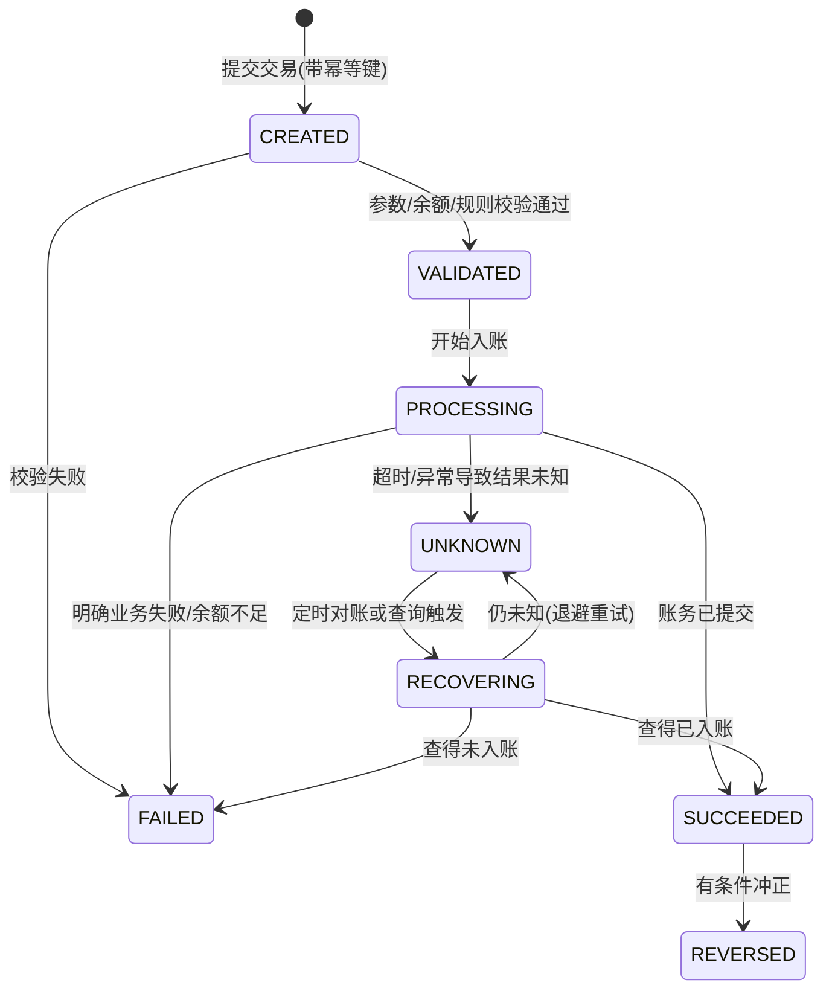

# 交易服务详细设计（LLD）

> 状态：设计中 · 依赖 `accounting-design.md` / `consistency.md`

## 一、职责与边界

Transaction 负责 **交易意图的生命周期与状态一致性**，不负责记账。记账由 ledger 在同一事务内完成。状态机是交易正确性的骨架，禁止绕过状态机直接改状态。

## 二、状态机



### 合法迁移表

| From | To | 触发 | 是否写账务 |
| --- | --- | --- | --- |
| CREATED | VALIDATED | 校验通过 | 否 |
| CREATED | FAILED | 校验失败 | 否 |
| VALIDATED | PROCESSING | 调用入账 | 否（同事务内） |
| PROCESSING | SUCCEEDED | 账务提交成功 | 是 |
| PROCESSING | FAILED | 余额不足/业务拒绝 | 否 |
| PROCESSING | UNKNOWN | 超时/未知异常 | 不确定，需查 |
| UNKNOWN | RECOVERING | 查询/对账任务 | 否 |
| RECOVERING | SUCCEEDED / FAILED | 依据账务查询结果 | 否 |
| SUCCEEDED | REVERSED | 冲正请求 | 是（反向分录） |

**非法跳转一律拒绝**（如 FAILED → SUCCEEDED、REVERSED → SUCCEEDED、CREATED → SUCCEEDED）。状态更新用 CAS：

```sql
UPDATE transaction
SET status = ?, version = version + 1
WHERE transaction_id = ? AND status = ? AND version = ?;
-- 影响行数必须为 1，否则视为并发冲突并重试/报错
```

## 三、四个必须区分的概念（README 4.3）

| 概念 | 含义 | 处理 |
| --- | --- | --- |
| 请求超时 / UNKNOWN | 不知道交易是否成功 | **不得直接重试业务**，先查询 |
| 业务失败 FAILED | 明确未完成、未入账 | 可安全重试（新幂等键） |
| 已入账 SUCCEEDED | 核心账务已提交 | 不可重复入账 |
| 外部结算完成 | 资金完成跨机构结算 | 阶段一不存在，阶段二引入 |

这是金融核心与普通 CRUD 的关键差异：**超时不等于失败**。

## 四、幂等设计

- 客户端必传 `Idempotency-Key`（UUID 或业务单号），服务端建唯一索引 `(tenant_id, idempotency_key)`。
- 请求参数做哈希 `request_hash`，同键不同参数 → 返回 `409 CONFLICT`，防止键复用。
- 首次请求在同一事务内插入 `idempotency_record`；唯一键冲突时读取并 **返回首次结果快照**（状态码 + 响应体），不重新执行业务。
- 幂等记录与交易状态、分录、余额、Outbox **同一事务**写入，避免「记录了但未入账」或反之。

```
请求 → 查幂等记录
  ├─ 存在且成功 → 直接返回快照（不执行业务）
  ├─ 存在且处理中 → 返回 202 + 原交易号（客户端轮询）
  └─ 不存在 → 插入记录 → 执行业务 → 同事务提交 → 写回结果
```

详见 ADR-0005 与 `consistency.md`。

## 五、超时与恢复

- 交易表带 `created_at`、`updated_at`、`next_retry_at`。
- 定时任务扫描 `status IN (UNKNOWN, RECOVERING)` 且超时的记录，按交易号查询账务事实：
  - 命中已生效凭证 → 迁移 SUCCEEDED（补状态，不补账）。
  - 未命中 → 迁移 FAILED（明确未入账）。
  - 仍不确定 → 指数退避，保留 UNKNOWN，告警。
- 恢复逻辑 **以账务分录为准**，不以本地状态为准，因为账务是权威数据源。

## 六、核心字段（逻辑模型）

| 字段 | 说明 |
| --- | --- |
| `transaction_id` | 全局唯一 ID（阶段一可用 DB 序列/雪花） |
| `idempotency_key` | 幂等键，与 tenant 联合唯一 |
| `type` | TRANSFER / DEPOSIT / WITHDRAW / REVERSAL |
| `status` | 状态机枚举 |
| `payer_account_id` / `payee_account_id` | 收付款账户 |
| `amount_minor` / `currency` | 最小单位金额与币种 |
| `version` | 乐观锁 |
| `request_hash` | 幂等参数校验 |
| `journal_id` | 关联凭证（入账后回填） |

DDL 见 `database-design.md`。

## 七、对外接口（阶段一）

| 方法 | 路径 | 说明 |
| --- | --- | --- |
| POST | `/v1/transactions` | 提交交易，Header 必带 `Idempotency-Key` |
| GET | `/v1/transactions/{id}` | 按交易号查询最终状态 |
| GET | `/v1/transactions:byKey/{key}` | 按幂等键查询（超时恢复用） |
| POST | `/v1/transactions/{id}:reverse` | 冲正（生成反向分录） |

## 八、与账务的协作（同一事务）

```
TransactionApplication.transfer(cmd)  @Transactional
  ├─ 1 幂等检查 / 插入幂等记录
  ├─ 2 创建交易 CREATED → VALIDATED → PROCESSING
  ├─ 3 account 条件扣减余额（条件 UPDATE）
  ├─ 4 ledger.post(journal)：校验 ΣD=ΣC，写分录
  ├─ 5 回填 journal_id，状态 SUCCEEDED
  ├─ 6 写 outbox_event（阶段二投递用）
  └─ commit  ← 原子边界，任一步失败整体回滚
```

任一环节抛异常 → 整体回滚，状态回到可重试态，账务不残留。详见 ADR-0003 与 `database-design.md` 第六节。
